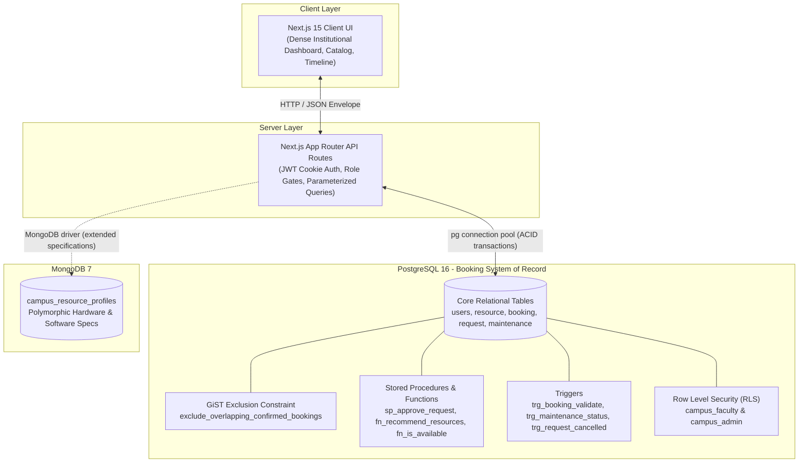

# Campus Resource Allocation & Conflict Detection Platform

**Course**: Database Management Systems (DBMS) Mini-Project

**Project team**

- Rakshan R (PES1UG24CS365)
- Rajat Kooge (PES1UG24CS362)

**Technology Stack**: Next.js 15 (App Router), TypeScript, Tailwind CSS, PostgreSQL 16 (`btree_gist`), MongoDB 7, `pg`, official `mongodb` driver, Zod, bcryptjs, jose, Recharts, lucide-react.

---

## 1. System Architecture & Cross-Store Boundary



### Store Separation Rationale
- **PostgreSQL 16**: The sole authoritative source of truth for user authentication, role enforcement, resource capacity, booking allocations, time-slot conflict detection, approvals, cancellations, and maintenance downtime. Enforces strict ACID compliance, serializable row locking (`FOR UPDATE`), and mathematical overlap prevention via `btree_gist` exclusion constraints.
- **MongoDB 7**: Employed solely for polymorphic, variable resource specifications (e.g. computer lab GPU models, software packages array `["Docker", "MATLAB"]`, auditorium stage dimensions, acoustics, and accessibility features). **MongoDB never stores or duplicates booking, request, or authorization records.** If a profile is absent, the system falls back to `"No extended specifications recorded"`.

---

## 2. One-Command Setup & Launch

### Prerequisites
- Node.js 20+ / 22+
- Docker & Docker Compose (or local PostgreSQL 16 and MongoDB instances)

### Quick Start
```bash
# 1. Clone repository and navigate to root
git clone https://github.com/rakshan-2006/campus-resource-platform.git
cd campus-resource-platform

# 2. Install all dependencies
npm ci

# 3. Start PostgreSQL and MongoDB (via Docker Compose)
docker compose up -d --wait

# 4. Run automated database setup (DDL migration, relational seed, Mongo validation & seed)
npm run db:setup

# 5. Launch development server
npm run dev
```

Open your browser at **`http://localhost:3000`**.

`db:setup` resets the demo data. To upgrade a database created by the previous version and keep its rows, back it up and run `npm run db:migrate -- --upgrade-level-3` instead. Restart the app after upgrading.

Booking, request, approval and dashboard queries select a PostgreSQL role for
each authenticated transaction. Faculty can access their own records and see
anonymous occupancy on shared timelines.

---

## 3. Demo Credentials

Three deterministic accounts are pre-seeded in PostgreSQL:

| Role | Name | Email | Password | Scope & Department |
| :--- | :--- | :--- | :--- | :--- |
| **ADMIN** | Dr. Alan Turing | `admin@campus.edu` | `Admin@123` | Campus Administration — Full triage & override rights |
| **FACULTY** | Dr. Grace Hopper | `faculty1@campus.edu` | `Faculty@123` | Computer Science & Engineering |
| **FACULTY** | Dr. Claude Shannon | `faculty2@campus.edu` | `Faculty@123` | Electronics & Communication Engineering |

> [!NOTE]
> The development server displays one-click prefill buttons. Production blocks the three seeded demo accounts. Before running a production server, provision real accounts with bcrypt password hashes and configure a unique random `JWT_SECRET` of at least 32 characters. Generate one with `node -e "console.log(require('crypto').randomBytes(32).toString('hex'))"`. The supplied Compose setup is for local use and binds both database ports to loopback.

---

## 4. Key Database Features Implemented

1. **GiST Exclusion Constraint (`exclude_overlapping_confirmed_bookings`)**:
   - Engine-level prevention of double-booking:
     ```sql
     CONSTRAINT exclude_overlapping_confirmed_bookings 
     EXCLUDE USING gist (resource_id WITH =, tsrange(start_time, end_time) WITH &&) 
     WHERE (status = 'CONFIRMED');
     ```
2. **Transparent Explainable Recommendations (`fn_recommend_resources`)**:
   - Hard-filters available candidates, then computes transparent weighted component scores:
     - **Capacity Fit (30%)**: Scaled to penalize excessive room hoarding.
     - **Facilities Match (30%)**: Verifies required vs available item quantities.
     - **Availability (25%)**: Confirmed free window.
     - **Type Match (10%)**: Exact classification match.
     - **Location / Campus Base (5%)**: Department affinity score.
3. **Atomic Admin Approval Stored Procedure (`sp_approve_request`)**:
   - Validates admin credentials, locks `booking_request` with `FOR UPDATE`, checks `fn_is_available()`, updates request to `APPROVED`, and inserts one `CONFIRMED` booking. Concurrent approval attempts serialize cleanly; the second attempt is rejected with a conflict error.
4. **Maintenance State Synchronization Trigger (`trg_maintenance_status`)**:
   - Flips resource `status` to `'MAINTENANCE'` when servicing begins (`IN_PROGRESS`), and automatically restores `'AVAILABLE'` when maintenance is completed or cancelled.
5. **Request Cancellation Cascade Trigger (`trg_request_cancelled`)**:
   - Automatically cancels associated confirmed bookings when a request is cancelled.
6. **Row Level Security (RLS) & Faculty Isolation**:
   - Connection context `app.current_user_id` isolates faculty so direct queries cannot access or modify another faculty member's requests.

---

## 5. Verification Commands

Run the automated test suites to verify all rubric requirements:

```bash
# 1. Advanced Database Features Suite (Exclusion constraint, triggers, functions, RLS)
npm run test:db

# 2. Integration & NoSQL Boundary Suite (JWT lifecycle, Mongo profile fallback, views)
npm run test:integration

# 3. TypeScript Typecheck
npm run typecheck

# 4. Production Build
npm run build
```

---

## 6. Architectural Decisions Log

| Decision | Rationale |
| :--- | :--- |
| **Raw SQL (`pg`) over ORM** | Explicit control over parameterized queries, transaction isolation, GiST exclusion constraints, and stored procedure calls without ORM impedance mismatch. |
| **Single `users` Entity** | Enforces uniform credentials, department keys, and unique emails without redundant schema tables. Role discriminator `role IN ('ADMIN', 'FACULTY')`. |
| **Raw Timestamp Strings (`TIMESTAMP WITHOUT TIME ZONE`)** | Campus operating times are local wall-clock hours (`YYYY-MM-DD HH:mm`). Zone conversion via JavaScript `Date` was strictly disabled (`types.setTypeParser(1114, val => val)`). |
| **Advisory NoSQL Specifications** | Extended hardware/software specifications differ across labs and auditoriums. Placing them in MongoDB avoids table bloat while keeping bookings strictly relational. |
| **Dense Institutional UI** | Calm, slate/navy operations dashboard prioritizing data density, accessible focus states, and practical tables over superficial styling. |

---

## 7. Limitations & Future Work

- **Multi-Day Recurring Bookings**: Currently, reservations are evaluated per discrete start/end window. Future iterations could support weekly recurring timetable slots with automated batch conflict detection.
- **Resource Swapping Optimizer**: When a high-priority institutional event requires an already booked auditorium, an automated suggestion engine could propose equivalent alternative venues to displaced faculty.
- **Dynamic Energy Integration**: Syncing HVAC/lighting controllers via campus IoT webhooks based on confirmed active booking intervals.

---

## 8. Viva Walkthrough Guide (Examiner Brief)

1. **Why PostgreSQL is authoritative**: All reservation logic involves serializable concurrency and referential integrity. PostgreSQL guarantees zero double-bookings via its GiST exclusion constraint and row-level locks in `sp_approve_request`.
2. **Why MongoDB is limited to flexible profiles**: Hardware configurations (CPUs, RAM, 20+ software packages) and auditorium stage setups are semi-structured and vary wildly. MongoDB's document model and multikey array indexing handle this without polluting relational tables.
3. **The Conflict Rule**: Overlapping intervals are defined as `new_start < existing_end AND new_end > existing_start`.
4. **Contributions**: Rakshan R built the foundation, database schema, authentication, core APIs, recommendation engine, and core user flows. Rajat Kooge built admin resource management, maintenance scheduling, and analytics. See the [implementation history](docs/CONTRIBUTIONS.md) for the related pull requests.
