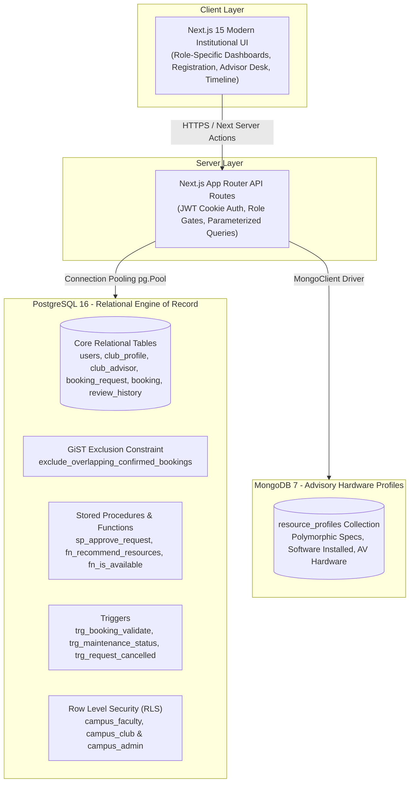
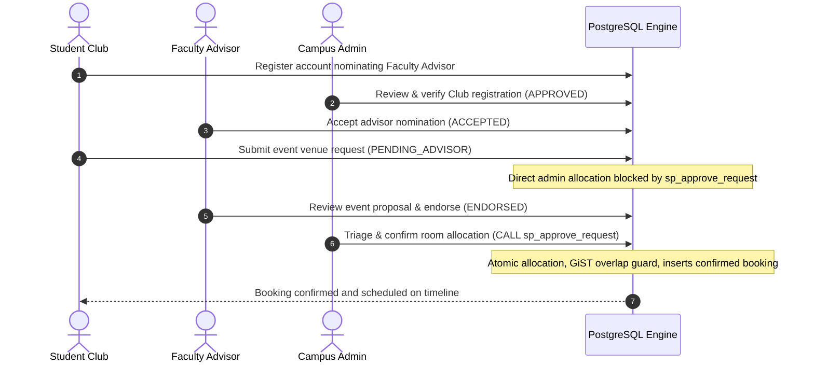

# Campus Resource Allocation & Conflict Detection Platform

**Course**: Database Management Systems (DBMS) Mini-Project

**Project Team**:
- Rakshan R (PES1UG24CS365)
- Rajat Kooge (PES1UG24CS362)

**Technology Stack**: Next.js 15 (App Router), TypeScript strict, Tailwind CSS, PostgreSQL 16 (`btree_gist`), MongoDB 7, `pg`, official `mongodb` driver, Zod, bcryptjs, jose, Recharts, lucide-react.

---

## 1. System Architecture & Cross-Store Boundary



---

## 2. Quickstart & Local Setup

```bash
# 1. Clone repository
git clone https://github.com/rakshan-2006/campus-resource-platform.git
cd campus-resource-platform

# 2. Install all dependencies
npm install

# 3. Start PostgreSQL and MongoDB (via Docker Compose or local daemons)
docker compose up -d

# 4. Run automated database setup (DDL migration, seed data, and MongoDB initialization)
npm run db:setup

# 5. Apply Club Account & Advisor Review Workflow Migration
npm run db:migrate:club

# 6. Launch development server
npm run dev
```

Open your browser at **`http://localhost:3000`**.

`db:setup` resets the demo data. To upgrade a database created by the previous version and keep its rows, back it up and run `npm run db:migrate -- --upgrade-level-3` instead. Restart the app after upgrading.

Booking, request, approval and dashboard queries select a PostgreSQL role for each authenticated transaction. Faculty and Clubs can access their own records and see anonymous occupancy on shared timelines.

---

## 3. Seeded Accounts & Demo Scenarios

Deterministic demo accounts are pre-seeded in PostgreSQL. The `/login` page provides **one-click pre-fill cards** for testing:

| Role | Name | Email | Password | Scope & Role Profile |
| :--- | :--- | :--- | :--- | :--- |
| **ADMIN** | Dr. Alan Turing | `admin@campus.edu` | `Admin@123` | Campus Administration — Registrations desk, triage & final allocation |
| **FACULTY** | Dr. Grace Hopper | `faculty1@campus.edu` | `Faculty@123` | CS Dept Faculty & Active Advisor for ACM Student Chapter |
| **FACULTY** | Dr. Claude Shannon | `faculty2@campus.edu` | `Faculty@123` | ECE Dept Faculty & Active Advisor for Robotics Society |
| **CLUB** | ACM Student Chapter | `club1@campus.edu` | `Club@123` | Verified Club (Advised by Dr. Grace Hopper) |
| **CLUB** | Robotics Society | `club2@campus.edu` | `Club@123` | Verified Club (Advised by Dr. Claude Shannon) |
| **PENDING CLUB** | Design Guild | `pending.club@campus.edu` | `Club@123` | Self-registered Club awaiting Admin verification |
| **PENDING FACULTY** | Dr. John von Neumann | `pending.faculty@campus.edu` | `Faculty@123` | Self-registered Faculty applicant awaiting Admin verification |

> [!NOTE]
> The development server displays one-click prefill buttons. Production blocks the three seeded demo accounts. Before running a production server, provision real accounts with bcrypt password hashes and configure a unique random `JWT_SECRET` of at least 32 characters. Generate one with `node -e "console.log(require('crypto').randomBytes(32).toString('hex'))"`. The supplied Compose setup is for local use and binds both database ports to loopback.

---

## 4. Multi-Stage Club & Advisor Review Workflow



---

## 5. Verification & Test Suites

```bash
# 1. Run PostgreSQL Advanced Database Feature Suite (GiST constraints, procedures, triggers, RLS)
npm run test:db

# 2. Run Admin Feature Extensions Suite (Catalog CRUD, Maintenance lifecycle, Analytics, Mongo profiles)
npm run test:admin

# 3. Run Club Workflow & Multi-Stage Advisor Review Integration Suite
npm run test:club

# 4. Run All Automated Verification Suites Sequentially
npm run test:all

# 5. TypeScript Strict Typecheck
npm run typecheck

# 6. Next.js Production Build
npm run build
```

---

## 6. Architectural Decisions

| Decision | Rationale |
| :--- | :--- |
| **Raw SQL (`pg`) over ORM** | Explicit control over parameterized queries, transaction isolation, GiST exclusion constraints, and stored procedure calls without ORM impedance mismatch. |
| **PostgreSQL as Single Source of Truth** | All reservation logic involves serializable concurrency and referential integrity. PostgreSQL guarantees zero double-bookings via its GiST exclusion constraint and row-level locks in `sp_approve_request`. |
| **Advisory NoSQL Specifications** | Extended hardware/software specifications differ across labs and auditoriums. Placing them in MongoDB avoids table bloat while keeping bookings strictly relational. |
| **Raw Timestamp Strings (`TIMESTAMP WITHOUT TIME ZONE`)** | Campus operating times are local wall-clock hours (`YYYY-MM-DD HH:mm`). Zone conversion via JavaScript `Date` was strictly disabled (`types.setTypeParser(1114, val => val)`). |
| **Multi-Stage Review Workflow** | Club requests require faculty endorsement before admin triage. Modeled as a separate review stage (`advisor_review_status`) to preserve existing faculty booking flow. |
| **Dense Institutional UI** | Calm, slate/navy operations dashboard prioritizing data density, accessible focus states, and practical tables over superficial styling. |

---

## 7. Database Migration & Schema Details

- **Migration Script**: `db/migration-club-workflow.sql` (Executed via `npm run db:migrate:club`).
- **Fresh-Install Schema**: `db/schema.sql` contains the complete authoritative schema including all tables, constraints, views, stored procedures, triggers, and roles.
- **ER Diagram**: Documented in [`docs/ERD.md`](file:///c:/Acad/Sem%205/DBMS%20Project/docs/ERD.md).

---

## 8. Limitations & Future Work

- **Multi-Day Recurring Bookings**: Currently, reservations are evaluated per discrete start/end window. Future iterations could support weekly recurring timetable slots with automated batch conflict detection.
- **Resource Swapping Optimizer**: When a high-priority institutional event requires an already booked auditorium, an automated suggestion engine could propose equivalent alternative venues to displaced faculty.
- **Dynamic Energy Integration**: Syncing HVAC/lighting controllers via campus IoT webhooks based on confirmed active booking intervals.

---

## 9. Viva Walkthrough Guide (Examiner Brief)

1. **Why PostgreSQL is authoritative**: All reservation logic involves serializable concurrency and referential integrity. PostgreSQL guarantees zero double-bookings via its GiST exclusion constraint and row-level locks in `sp_approve_request`.
2. **Why MongoDB is limited to flexible profiles**: Hardware configurations (CPUs, RAM, 20+ software packages) and auditorium stage setups are semi-structured and vary wildly. MongoDB's document model and multikey array indexing handle this without polluting relational tables.
3. **The Conflict Rule**: Overlapping intervals are defined as `new_start < existing_end AND new_end > existing_start`.
4. **Contributions**: Rakshan R built the foundation, database schema, authentication, core APIs, recommendation engine, club account workflow, and advisor review. Rajat Kooge built admin resource management, maintenance scheduling, and analytics. See the [implementation history](docs/CONTRIBUTIONS.md) for the related pull requests.
