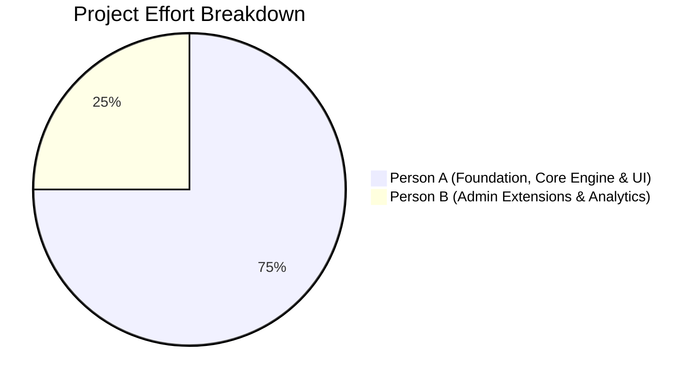

# Team Work Breakdown & Contribution Attribution

## Campus Resource Allocation & Conflict Detection Platform

This project is authored by a two-member development team adhering strictly to the modular architectural boundary defined in Milestone 0.

---

## 1. Work Allocation Overview

---

## 2. Detailed Ownership Breakdown

### Person A (Main Developer - 75% Project Scope)
- **Architectural Foundation**:
  - Full application scaffolding with Next.js 15 App Router, TypeScript strict mode, and Tailwind CSS.
  - PostgreSQL 16 Docker Compose configuration, connection pooling (`pg`), dedicated-client transactions, and error mapping.
  - MongoDB 7 setup, JSON Schema validation rules, multikey indexing, and fallback handling.
- **Relational Schema Design & Implementation**:
  - Authored `db/schema.sql`: 10 normalized tables, named PK/FK/CHECK/UNIQUE/NOT NULL constraints.
  - Implemented GiST exclusion constraint (`exclude_overlapping_confirmed_bookings`) using `btree_gist`.
  - Implemented stored functions: `fn_is_available`, `fn_recommend_resources` (weighted multi-component scoring), `fn_set_current_user_id`.
  - Implemented stored procedure: `sp_approve_request` with row-level locks (`FOR UPDATE`).
  - Implemented database triggers: `trg_booking_validate`, `trg_maintenance_status`, `trg_request_cancelled`.
  - Created operational views: `v_resource_utilization`, `v_peak_hours`, `v_pending_requests`.
  - Configured PostgreSQL roles (`campus_admin`, `campus_faculty`) and Row Level Security (RLS) policies.
- **Data & Queries**:
  - Created deterministic PostgreSQL seed dataset (`db/seed.sql`) with 3 demo accounts.
  - Authored comprehensive Query Workbook (`db/query-workbook.sql`) containing DML, joins, aggregations, recursive CTEs, and MongoDB RUD statements.
- **Backend APIs & Authentication**:
  - Implemented secure JWT httpOnly session authentication, bcrypt hashing, and server-side role checks (`src/lib/auth.ts`).
  - Implemented all core API endpoints: `/api/auth/*`, `/api/metadata`, `/api/resources/*`, `/api/availability`, `/api/recommendations`, `/api/requests/*`, `/api/bookings/*`, `/api/admin/requests/*`, `/api/dashboard`, and `/api/health`.
- **Frontend & User Interface**:
  - Built custom campus UI kit (`Button`, `Badge`, `Input`, `Select`, `Table`, `ScoreBar`, `Timeline`).
  - Implemented Login, Dashboard, Resource Explorer, Resource Detail (dual-store view), New Request & Recommendation Flow, My Requests, Campus Bookings, and Admin Request Approvals.
  - Implemented placeholder routes for Person B: `/admin/resources`, `/admin/maintenance`, `/admin/analytics`.
- **Marking Documentation**:
  - Authored `docs/ERD.md`, `docs/RELATIONAL_SCHEMA.md`, `docs/NOSQL_DESIGN.md`, `docs/DATABASE_FEATURES.md`, `docs/API.md`, `docs/CONTRACT.md`, `docs/TEST_PLAN.md`, `docs/DEMO_SCRIPT.md`, and `README.md`.

---

### Person B (Secondary Developer - 25% Project Scope)
*Assigned to clone after Milestone 0 and implement via Pull Requests:*
- **Admin Resource Management**:
  - CRUD UI and API routes for managing resources, resource types, and facilities.
  - CRUD interface for MongoDB extended specifications profiles.
- **Admin Maintenance Operations**:
  - Maintenance scheduling and inspection interface (`/admin/maintenance`).
  - Integration with maintenance status triggers.
- **Admin Analytics Visualizations**:
  - Analytics dashboards and Recharts visuals utilizing `v_resource_utilization` and `v_peak_hours`.
- **Demonstration Artifacts**:
  - `db/demo-data.sql` (supplementary edge-case fixtures).
  - `scripts/demo-conflict.sql` (examiner conflict demonstration script).
  - `docs/ADMIN_FEATURES.md` (Person B user guide and feature summary).

---

## 3. Git Commits & Integration Log

| Milestone | Commit Tag | Description | Author |
| :--- | :--- | :--- | :--- |
| Milestone 0 | `m0-foundation` | Scaffolding, Docker, DDL, seeds, auth, UI kit, docs, contracts, Person B placeholders | Person A |
| Milestone 1 | `m1-api` | Core database functions/procedures/triggers, RLS, all A-owned API routes, integration tests | Person A |
| Milestone 2 | `m2-pages` | Real-time interactive UI pages (catalog, recommendation wizard, requests, bookings, admin triage) | Person A |
| Milestone 3 | `m3-submission` | End-to-end verification, test plan execution, README and submission packaging | Person A |
| PR #1 (Merged) | Commit `6da462c` | Admin resource CRUD, type/facility management, MongoDB profile editor (`/admin/resources`) | Person B (`rajatkooge5-learn`) |
| PR #2 (Merged) | Commit `10a8e45` | Admin maintenance scheduling UI, booking conflict check, trigger sync (`/admin/maintenance`) | Person B (`rajatkooge5-learn`) |
| PR #3 (Merged) | Commit `9f36ed5` | Admin analytics dashboard, Recharts visualizations, `db/demo-data.sql`, `scripts/demo-conflict.sql` | Person B (`rajatkooge5-learn`) |
