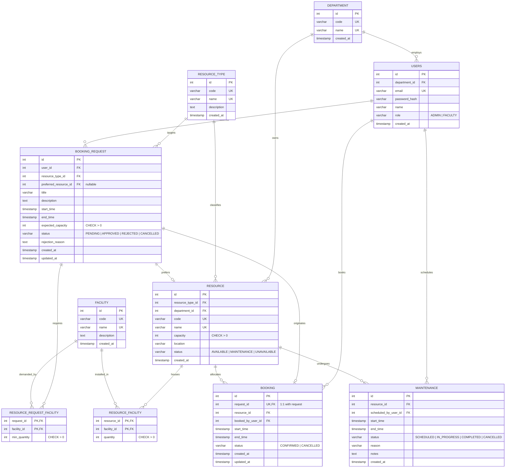

# Entity-Relationship Diagram (ERD)

## Campus Resource Allocation & Conflict Detection Platform

This document presents the relational structure of the campus platform using crow's-foot notation. PostgreSQL serves as the authoritative source of truth for all transactional entities.

## Cardinality & Business Rules Summary

1. **Department to Users (`1:N`)**: Each user belongs to exactly one department. A department employs zero or more users.
2. **Department to Resource (`1:N`)**: Each resource belongs to one administrative department (e.g. CS Lab owned by CS Department).
3. **Resource Type to Resource (`1:N`)**: A resource type (Classroom, Computer Lab, Seminar Hall, Conference Room, Auditorium) classifies multiple resources.
4. **Resource to Facility (`M:N` via `resource_facility`)**: A resource can have multiple physical facilities with tracked positive quantities (e.g. 40 Workstations, 1 Projector).
5. **Booking Request to Facilities (`M:N` via `resource_request_facility`)**: Faculty specify minimum facility quantities required for their session.
6. **Booking Request to Booking (`1:0..1`)**: A request has at most one confirmed booking (`request_id UNIQUE` in `booking`). Pending, rejected, or cancelled requests have no active booking.
7. **Resource to Booking (`1:N`)**: A resource can be booked for multiple distinct, non-overlapping time intervals. Overlapping confirmed bookings are strictly forbidden by a PostgreSQL GiST exclusion constraint.
8. **Resource to Maintenance (`1:N`)**: A resource can undergo multiple scheduled or emergency maintenance periods.
9. **Single Users Table**: Exactly one `users` entity with role discriminator `role IN ('ADMIN', 'FACULTY')`. No redundant admin/faculty tables.
10. **MongoDB Cross-Store Reference**: MongoDB collection `campus_resource_profiles` maintains variable, semi-structured hardware/seating specifications linked via `pg_resource_id` (`1:0..1` relationship).
