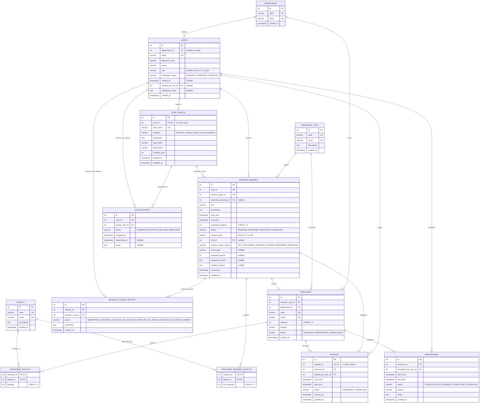

# Entity-Relationship Diagram (ERD)

## Campus Resource Allocation & Conflict Detection Platform

This document presents the complete relational structure of the campus platform using crow's-foot notation. PostgreSQL serves as the authoritative source of truth for all transactional entities, user accounts, club profiles, advisor relationships, and review history.

## Cardinality & Business Rules Summary

1. **Department to Users (`1:N`)**: Academic faculty belong to an academic department. Student Clubs associate with the Student Affairs department (`SA`).
2. **Users & Club Profiles (`1:1`)**: When an applicant registers with `role = 'CLUB'`, a corresponding record in `club_profile` stores organization metadata (lead contact, category, description, founded year) rather than cluttering the generic `users` table.
3. **Faculty Advisor Relationship (`M:N` via `club_advisor`)**: "Faculty Advisor" is an institutional mentorship relationship, not a separate global role. A faculty member retains `role = 'FACULTY'` and can advise multiple clubs. Each active club has exactly one `ACCEPTED` advisor enforced by a partial unique index (`uq_club_active_advisor`).
4. **Multi-Stage Review Workflow (`booking_request` & `request_review_history`)**:
   - Faculty academic requests have `request_type = 'FACULTY'` and `advisor_review_status = 'NOT_APPLICABLE'`, flowing directly to administrative triage.
   - Club requests have `request_type = 'CLUB'` and start in `advisor_review_status = 'PENDING_ADVISOR'`.
   - The designated faculty advisor must review and `ENDORSE` the proposal before it advances to admin triage.
   - Advisor endorsement signals academic support; it never creates a confirmed booking.
   - Administrative allocation calls the engine-level stored procedure `sp_approve_request`, which verifies advisor endorsement and runs availability conflict checks before inserting a confirmed booking.
5. **Review History Audit Trail (`request_review_history`)**: Every state transition (`SUBMITTED`, `ENDORSED`, `REJECTED_BY_ADVISOR`, `APPROVED_BY_ADMIN`, `REJECTED_BY_ADMIN`) logs reviewer ID, timestamp, and comments for full institutional transparency.
6. **Booking Request to Booking (`1:0..1`)**: A request produces at most one confirmed booking (`request_id UNIQUE` in `booking`).
7. **Resource to Booking (`1:N`)**: A resource can be booked for multiple distinct, non-overlapping intervals. Overlapping confirmed bookings are strictly blocked at the engine level by a PostgreSQL GiST exclusion constraint (`btree_gist`).
8. **MongoDB Extended Profile (`1:0..1`)**: MongoDB collection `campus_resource_profiles` maintains variable, semi-structured hardware/seating specifications linked via `pg_resource_id`.
